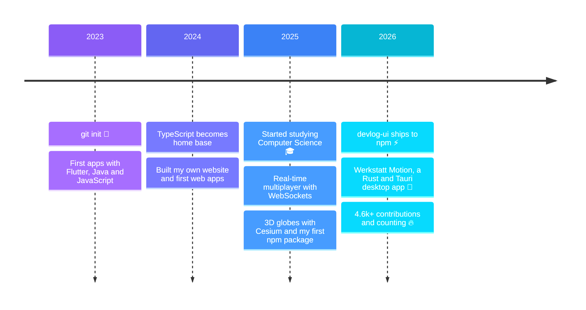

<!-- ════════════════════════════════  HEADER  ════════════════════════════════ -->


<p align="center">
  <picture>
    <source media="(prefers-color-scheme: dark)" srcset="https://readme-typing-svg.demolab.com?font=JetBrains+Mono&weight=500&size=17&duration=1700&pause=450&color=A78BFA&multiline=true&repeat=false&width=640&height=130&lines=%3E+booting+oko-tester+...;%3E+loading+modules%3A+typescript+%C2%B7+rust+%C2%B7+react+%C2%B7+cesium;%3E+found+4.6k%2B+contributions+%26+2+npm+packages;%3E+ready.+welcome+to+my+corner+of+github+%F0%9F%91%8B" />
    <source media="(prefers-color-scheme: light)" srcset="https://readme-typing-svg.demolab.com?font=JetBrains+Mono&weight=500&size=17&duration=1700&pause=450&color=7C3AED&multiline=true&repeat=false&width=640&height=130&lines=%3E+booting+oko-tester+...;%3E+loading+modules%3A+typescript+%C2%B7+rust+%C2%B7+react+%C2%B7+cesium;%3E+found+4.6k%2B+contributions+%26+2+npm+packages;%3E+ready.+welcome+to+my+corner+of+github+%F0%9F%91%8B" />
     booting oko-tester … ready. welcome to my corner of github 👋" src="https://readme-typing-svg.demolab.com?font=JetBrains+Mono&weight=500&size=17&duration=1700&pause=450&color=7C3AED&multiline=true&repeat=false&width=640&height=130&lines=%3E+booting+oko-tester+...;%3E+loading+modules%3A+typescript+%C2%B7+rust+%C2%B7+react+%C2%B7+cesium;%3E+found+4.6k%2B+contributions+%26+2+npm+packages;%3E+ready.+welcome+to+my+corner+of+github+%F0%9F%91%8B" />
  </picture>
</p>

<p align="center">
  I like building software that feels <b>effortless</b> —<br />
  from 3D globes in the browser to desktop apps for car repair shops.
</p>

<p align="center">
  <a href="https://www.npmjs.com/~oko-tester"></a>
  
</p>

<!-- ════════════════════════════════  WHOAMI  ════════════════════════════════ -->

## ❯ whoami

```text
                               alexander@github
 ██████╗ ██╗  ██╗ ██████╗      ────────────────────────────────────────────
██╔═══██╗██║ ██╔╝██╔═══██╗     Role ········ Full-Stack Developer · CS Student
██║   ██║█████╔╝ ██║   ██║     Location ···· Germany
██║   ██║██╔═██╗ ██║   ██║     Uptime ······ since 03/2023 · 4.6k+ contributions
╚██████╔╝██║  ██╗╚██████╔╝     Kernel ······ TypeScript
 ╚═════╝ ╚═╝  ╚═╝ ╚═════╝      Also speaks · Rust · Python · Java · PHP · C++
                               Stack ······· React · Vite · Tauri · Node.js · Cesium
   ─── T E S T E R ───         Packages ···· 2 on npm · 5.6k+ downloads
                               Building ···· Werkstatt Motion
                               Exploring ··· AI agents · 3D on the web
                               Status ······ ● online & shipping

                               🟥🟧🟨🟩🟦🟪⬛⬜
```

<!-- ════════════════════════════════  PROJECTS  ══════════════════════════════ -->

## ❯ ls ~/projects --featured

<table>
<tr>
<td colspan="2">

### 🔧 [Werkstatt Motion](https://github.com/Oko-Tester/Werkstatt-Motion)

<a href="https://github.com/Oko-Tester/Werkstatt-Motion"></a>

The no-nonsense digital board for car repair shops: vehicles, appointments, TÜV dates and open payments at a glance.
No pop-ups, no sub-menus, no save button — every action takes **two clicks max**, right next to the car lift.
Works offline and backs itself up every day.

    

</td>
</tr>
<tr>
<td width="50%" valign="top">

### ⚡ [devlog-ui](https://github.com/Oko-Tester/devlog-ui)

`console.log` on steroids: a zero-dependency, framework-agnostic dev logger with a slick in-browser debug UI — spans, network capture, timeline view and **zero** production overhead.

<a href="https://www.npmjs.com/package/devlog-ui"></a> <a href="https://www.npmjs.com/package/devlog-ui"></a>

</td>
<td width="50%" valign="top">

### 🌍 [resium-entity-context-menu](https://github.com/Oko-Tester/resium-entity-context-menu)

Right-click menus for 3D globes: type-safe, accessible context menus for Cesium/Resium entities — declaratively controlled via React Context, async-ready.

<a href="https://www.npmjs.com/package/resium-entity-context-menu"></a> <a href="https://www.npmjs.com/package/resium-entity-context-menu"></a>

</td>
</tr>
<tr>
<td width="50%" valign="top">

### 🎮 [multiplayer-lobby-railway](https://github.com/Oko-Tester/multiplayer-lobby-railway)

A real-time multiplayer lobby with WebSockets — live chat, player sync and online counter. One-click deploy on Railway, built for hackathons & game jams.

`JavaScript` `WebSockets` `Docker` `Railway`

</td>
<td width="50%" valign="top">

### 📐 [geo-2-cart](https://github.com/Oko-Tester/geo-2-cart)

WGS84 ⇄ ECEF coordinate converter for geo nerds — numerically stable thanks to Bowring's method.

`React 19` `TypeScript` `Vite`

</td>
</tr>
</table>

<p align="right"><sub>🔒 Most of my contributions happen in private repos — products in the making. Stay tuned.</sub></p>

<!-- ════════════════════════════════  TOOLBOX  ═══════════════════════════════ -->

## ❯ ls ~/toolbox

<p align="center">
  <picture>
    <source media="(prefers-color-scheme: dark)" srcset="https://skillicons.dev/icons?i=ts%2Cjs%2Crust%2Cpy%2Cjava%2Cphp%2Ccpp%2Cdart&theme=dark" />
    <source media="(prefers-color-scheme: light)" srcset="https://skillicons.dev/icons?i=ts%2Cjs%2Crust%2Cpy%2Cjava%2Cphp%2Ccpp%2Cdart&theme=light" />
    
  </picture>
  <br /><sub><b>languages</b></sub>
</p>

<p align="center">
  <picture>
    <source media="(prefers-color-scheme: dark)" srcset="https://skillicons.dev/icons?i=react%2Cvite%2Ctauri%2Cnodejs%2Castro%2Cflutter%2Chtml%2Ccss&theme=dark" />
    <source media="(prefers-color-scheme: light)" srcset="https://skillicons.dev/icons?i=react%2Cvite%2Ctauri%2Cnodejs%2Castro%2Cflutter%2Chtml%2Ccss&theme=light" />
    
  </picture>
  <br /><sub><b>frameworks &amp; runtimes</b></sub>
</p>

<p align="center">
  <picture>
    <source media="(prefers-color-scheme: dark)" srcset="https://skillicons.dev/icons?i=git%2Cgithub%2Cgithubactions%2Cdocker%2Cpnpm%2Cnpm%2Cvitest%2Cjest&theme=dark" />
    <source media="(prefers-color-scheme: light)" srcset="https://skillicons.dev/icons?i=git%2Cgithub%2Cgithubactions%2Cdocker%2Cpnpm%2Cnpm%2Cvitest%2Cjest&theme=light" />
    
  </picture>
  <br /><sub><b>tooling</b></sub>
</p>

<p align="center"><sub>also in the box: Cesium · Resium · WebSockets · Babylon.js · Railway</sub></p>

<!-- ════════════════════════════════  JOURNEY  ═══════════════════════════════ -->

## ❯ git log --reverse



<!-- ════════════════════════════════  STATS  ═════════════════════════════════ -->

## ❯ ./stats.sh --live

<p align="center">
  <picture>
    <source media="(prefers-color-scheme: dark)" srcset="https://streak-stats.demolab.com?user=Oko-Tester&mode=weekly&background=120%2C1A1033%2C0D1117&border=30363D&stroke=3B3363&ring=8B5CF6&fire=22D3EE&currStreakNum=E6EDF3&sideNums=E6EDF3&currStreakLabel=A78BFA&sideLabels=A78BFA&dates=8B949E&border_radius=12" />
    <source media="(prefers-color-scheme: light)" srcset="https://streak-stats.demolab.com?user=Oko-Tester&mode=weekly&background=FFFFFF&border=D0D7DE&stroke=D0D7DE&ring=7C3AED&fire=0891B2&currStreakNum=1F2328&sideNums=1F2328&currStreakLabel=7C3AED&sideLabels=7C3AED&dates=656D76&border_radius=12" />
    
  </picture>
</p>

<!-- ════════════════════════════════  EASTER EGG  ════════════════════════════ -->

<details>
<summary><b>❯ sudo make coffee</b> &nbsp;<sub>(go on, click it)</sub></summary>
<br />

```console
$ sudo make coffee
[sudo] password for visitor: ••••••••
☕ grinding beans ·········· done
☕ brewing ················· done
✔ coffee delivered to your desk

🏆 Achievement unlocked: Curious Explorer
   You found the secret level. Go star a repo ⭐
```

</details>

<!-- ════════════════════════════════  FOOTER  ════════════════════════════════ -->

<p align="center">
  <code>❯ exit 0</code> &nbsp;·&nbsp; thanks for stopping by — let's build something that moves 🚀
</p>


